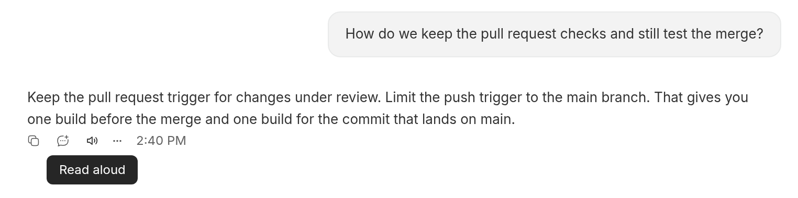

# Thread Reader

Listen to a BB thread, a single message, or text you select. The player lets you pause, skip to another passage, and change the speed from 0.75× to 2×.


## Install

You need BB 0.50 or later and an OpenAI API key with Realtime access.

```sh
bb plugin install git:https://github.com/vorsakha/bb-plugin-thread-reader.git@v0.1.4
```

Open **Settings → Installed plugins → Thread Reader** and enter your API key. Click the speaker beside **Voice** to hear a sample. The defaults are `gpt-realtime-2.1-mini` and the `marin` voice. To change the delivery, edit **Narration style** and preview it again.

## Read aloud

- **One message.** Hover over a message and click the speaker beneath it.
- **Selected text.** Highlight the passage and choose **Read aloud**.
- **Whole thread.** Open the thread menu and choose **Read thread aloud** to hear your messages and the assistant's replies in order.

The message button shows a spinner while narration loads and a stop icon during playback. Click it again to cancel or stop, even with the playback window hidden. For a whole-thread read, use the same action in the thread menu.



Drag the player by its dotted title area to place it anywhere in the BB window. Click the title to center the docked player or return a moved player to its dock. With the title focused, use the arrow keys to move it or Home to dock it.

**Show playback window** is on by default in Thread Reader settings. Turn it off to hide the player while narration continues. Turn it back on during a read to see the controls again.

To dismiss the player after the last passage, turn on **Close player when narration finishes** in Thread Reader settings. By default, the player stays open for replay.

## Privacy and cost

Your API key stays on the BB server. Thread Reader sends text to OpenAI one passage at a time and prepares one passage ahead. OpenAI bills your API project for narration and voice previews.
