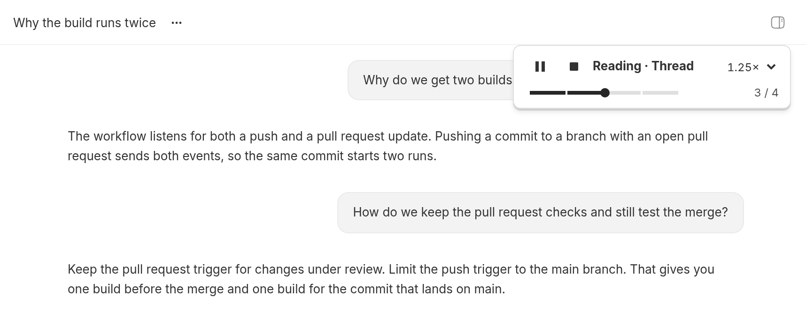

# Thread Reader

Listen to a BB thread, a single message, or text you select. The player lets you pause, skip to another passage, and change the speed from 0.75× to 2×.



## Install

You need BB 0.50 or later.

```sh
bb plugin install git:https://github.com/vorsakha/bb-plugin-thread-reader.git@v0.1.7
```

## Choose a narration provider

Open **Settings → Installed plugins → Thread Reader**. Under **Narration provider**, select the service you want to use. The voice and connection settings change with your selection.

### OpenAI Realtime

OpenAI Realtime is the default. Enter your project key in **OpenAI API key**, then click **Preview** beside **OpenAI voice**. The default model is `gpt-realtime-2.1-mini` and the default voice is `marin`. Use **Narration style** for directions such as “Pause between paragraphs.”

### Local Kokoro 82M

Kokoro runs on the BB server’s CPU and works without an API key. The plugin connects to a separate Kokoro-FastAPI service. If you use BB from another device, run the following command on the machine hosting BB.

```sh
docker run -d --name thread-reader-kokoro --restart unless-stopped \
  -p 127.0.0.1:8880:8880 --cpus=4 --memory=3g \
  -e OMP_NUM_THREADS=4 -e MKL_NUM_THREADS=4 -e CORS_ENABLED=false \
  ghcr.io/remsky/kokoro-fastapi-cpu:v0.10.0
```

Select **Local Kokoro 82M** and preview the default English voice, `af_heart`. Enter another voice ID in **Kokoro voice** to change the voice and language. [Kokoro voice list](https://huggingface.co/hexgrad/Kokoro-82M/blob/main/VOICES.md)

## Read aloud

- **One message.** Hover over a message and click the speaker beneath it.
- **Selected text.** Highlight the passage and choose **Read aloud**.
- **Whole thread.** Open the thread menu and choose **Read thread aloud** to hear your messages and the assistant's replies in order.

The message button shows a spinner while narration loads and a stop icon during playback. Click it again to cancel or stop, even with the playback window hidden. For a whole-thread read, use the same action in the thread menu.


Drag the player by its title to move it. With the title focused, use the arrow keys to move it or press Home to return it to the top right.

**Show playback window** is on by default in Thread Reader settings. Turn it off to hide the player while narration continues. Turn it back on during a read to see the controls again.

To dismiss the player after the last passage, turn on **Close window when finished** in Thread Reader settings. By default, the player stays open for replay.

## Privacy and cost

Thread Reader prepares one passage ahead. With local Kokoro, the BB server sends narration and previews to its loopback speech service. With OpenAI Realtime, the BB server sends passages to OpenAI and keeps your API key server-side. OpenAI bills your API project for narration and voice previews.
